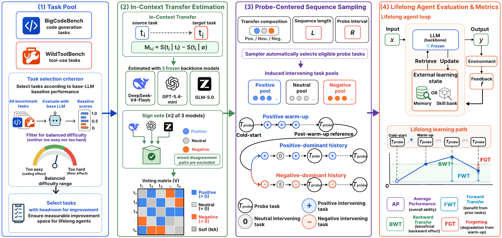

<h1 align="center">PATH-Bench</h1>
<p align="center"><strong>Path-Dependent Evaluation of Lifelong Agents</strong></p>
<p align="center">
  <a href="#quickstart">Quickstart</a> ·
  <a href="#connect-your-agent">Connect your agent</a> ·
  <a href="#run-an-evaluation">Run an evaluation</a> ·
  <a href="#design-your-own-paths">Design your own paths</a>
</p>

**Does solving one task help an agent solve the next one?** PATH-Bench asks an agent to solve the same task several times, with other tasks in between. That recurring task is the **probe**. Its changing score shows how the intervening experience helps or interferes with the agent.

Use the **200 fixed paths** to compare agents on the task orders from the paper. Use the **transfer matrices** to design a different experiment. Each dataset has 50 positive-dominant and 50 negative-dominant paths.



| Dataset | What the agent does | Paper paths | Transfer data |
| --- | --- | --- | --- |
| BigCodeBench · 120 tasks | Writes Python code that must pass the task's tests | [100 coding paths](paths/bigcodebench.jsonl) | [Gain and voting matrices](transfer/bigcodebench) |
| WildToolBench · 120 scenarios | Chooses tools and arguments across four English dialogue turns | [100 tool-use paths](paths/wildtoolbench.jsonl) | [Gain and voting matrices](transfer/wildtoolbench) |

## Quickstart

With **Python 3.10+**, you can check the release and score two example paths offline. This uses synthetic scores and requires only the Python standard library.

```sh
git clone https://github.com/Xidong-Yang/Pathbench.git
cd Pathbench
python evaluation/verify.py
python evaluation/score.py evaluation/examples/scores.csv --paths evaluation/examples/paths.jsonl
```

The scorer prints one row per dataset. These are the expected values, rounded here to four decimal places. [Full expected CSV](evaluation/examples/expected.csv)

| Dataset | AP | FWT | BWT | FGT |
| --- | ---: | ---: | ---: | ---: |
| BigCodeBench | 0.5172 | 0.5000 | 0.0000 | 0.5000 |
| WildToolBench | 0.4891 | 0.2500 | 0.1250 | 0.1250 |

## Connect your agent

**Already have a Chat Completions compatible endpoint?** Use the included [chat adapter](evaluation/examples/chat_agent.py). Set these variables in your shell, then choose a dataset under [Run an evaluation](#run-an-evaluation). The adapter appends `/chat/completions` to the base URL and sends temperature zero and the run seed. Adjust the request fields if your provider uses different controls.

```sh
export PATHBENCH_BASE_URL='https://your-provider.example/v1'
export PATHBENCH_MODEL='your-model-id'
export PATHBENCH_API_KEY='your-api-key'
```

**Already have your own agent?** Put its adapter in a Python file and pass that file to `--agent`. The runner calls two functions.

| Function | When it runs | What to return |
| --- | --- | --- |
| `respond(messages, tools, memory, seed)` | On each model call, including probes. `messages` is the current conversation. `tools` is an available-tool list for WildToolBench or `None` for BigCodeBench. | An assistant message dictionary. Return Python code in `content` for a coding task. For a tool action, return Chat Completions `tool_calls` with function arguments encoded as a JSON string. |
| `learn(memory, episode, seed)` *(optional)* | Once after each intervening task, including warm-up. The episode contains `task_id`, `score` and a `transcript` of messages and responses. | The memory to use on the next task. |

For example, if your agent already exposes a chat method, a thin adapter can delegate to it. Substitute your own import and method in this template. If the method returns an SDK response object, extract its assistant message and convert it to a dictionary.

```python
from my_project import agent

def respond(messages, tools, memory, seed):
    return agent.chat(messages=messages, tools=tools, memory=memory, seed=seed)
```

**Adding memory?** Each path and seed starts with `memory = {}`. The runner gives `respond` a copy. Only the return value of `learn` carries changes into the next task. A probe can read accumulated memory and is scored without invoking `learn`. If your agent uses an external store, give each run its own store and write to it from `learn`.

The [runnable memory adapter](evaluation/examples/memory_agent.py) keeps the first exchange from the last fully successful intervening task. On the next model call, it includes that exchange as a worked example. Try it by setting `AGENT=evaluation/examples/memory_agent.py` in the commands below.

## Run an evaluation

From the repository root, select an adapter. Point `AGENT` to your own file to test your integration.

```sh
AGENT=evaluation/examples/chat_agent.py
```

Choose one dataset. Both walkthroughs run **one short path with one seed**, write one score per task to `runs/`, and then summarize the run. Pass the same path file to both commands.

<details open>
<summary><strong>BigCodeBench · run the coding example</strong></summary>

The task inputs and tests are bundled. Install Docker and pull the pinned evaluator image once (about 9.3 GB compressed). It runs generated code in a network-disabled container. If you already have an isolated BigCodeBench evaluator with its sanitizer and task dependencies installed, you can use its interpreter via `--bcb-python`.

```sh
docker pull bigcodebench/bigcodebench-evaluate@sha256:a3cd34ec3840a49d6b7afb240f4bdd47c350bc5991043fd0a91773830f7cd405
python evaluation/run.py --dataset bigcodebench --condition positive --sequence 1 --seeds 42 \
  --paths evaluation/examples/paths.jsonl --agent "$AGENT" --name my-agent --output runs/bcb-example.csv
python evaluation/score.py runs/bcb-example.csv --paths evaluation/examples/paths.jsonl
```

</details>

<details>
<summary><strong>WildToolBench · run the tool-use example</strong></summary>

Fetch the pinned simulator, install its dependencies and reconstruct the task pool. Each scenario earns the fraction of turns with correct tool names and arguments.

```sh
git clone https://github.com/yupeijei1997/WildToolBench.git .deps/WildToolBench
git -C .deps/WildToolBench checkout --detach 69647d60b990b169267598573d91fdc00ba69bfb
python -m pip install -r evaluation/requirements-wtb.txt
python tasks/wildtoolbench/prepare.py --source .deps/WildToolBench/wild-tool-bench/data/Wild-Tool-Bench.jsonl

python evaluation/run.py --dataset wildtoolbench --condition positive --sequence 3 --seeds 42 \
  --paths evaluation/examples/paths.jsonl --agent "$AGENT" --name my-agent --output runs/wtb-example.csv
python evaluation/score.py runs/wtb-example.csv --paths evaluation/examples/paths.jsonl
```

</details>

<details>
<summary><strong>Full paper setting · 50 paths × 5 seeds per condition</strong></summary>

Omit `--paths`, `--sequence` and `--seeds` to run all official paths for one dataset and condition. Run `positive` and `negative` separately with distinct output files. BigCodeBench uses sequence IDs 1–50. WildToolBench uses 3, 6, …, 150. The five seeds are 42, 77, 117, 97 and 177.

```sh
python evaluation/run.py --dataset bigcodebench --condition positive \
  --agent "$AGENT" --name my-agent --output runs/bcb-positive.csv
python evaluation/score.py --official runs/bcb-positive.csv
```

For split runs, pass all CSV files together to the scorer. With `--official`, it checks that each dataset, condition and agent group includes the full set of paths and seeds. Step CSVs contain `dataset, condition, sequence_id, agent, seed, step, task_id, score`.

</details>

## Design your own paths

Read the matrix **down the probe's column**. If the probe is task B, the cell at row A, column B estimates how showing A changes performance on B. The three gain matrices give the one-shot score minus the zero-shot score for DeepSeek-V4-Flash, GLM-5 and gpt-5.4-mini. In `vote.csv`, a majority sign gives `1` (positive), `0` (neutral) or `-1` (negative). A three-way disagreement gives `2` (mixed).

**The paper's sampler is one example.** Its fixed paths start with a cold probe, five positive warm-up tasks, then a warm probe. Of the next 100 intervening tasks, 70 have the condition's dominant sign. The probe recurs after 6–12 tasks and at the end. The final gap can be shorter. The sampler excludes mixed pairs.

**Choose the history that fits your question.** For instance, to study recovery after interference, sample a negative-transfer block followed by a positive-transfer block and score the same probe after each. You can write your own sampler against the CSVs, or adjust the included example. This command samples three paths with a 90% negative share and gaps of 4–8 tasks.

```sh
python transfer/sample.py --dataset bigcodebench --condition negative --count 3 \
  --ratio 0.9 --intervals 4 8 --seed 101 --output runs/new-paths.jsonl
```

<details>
<summary><strong>Custom sampler output · JSONL format and a five-step example</strong></summary>

Write one JSON object per line. Use a unique `(dataset, condition, sequence_id)`, with task IDs from the selected pool. List every step in order, including repeats. Put all appearances of the probe in `probe_steps`, counted from one. The scorer needs at least three appearances, including the first and last steps. The positions between the first and second probes form `warmup_steps`.

This example uses a negative-transfer task before probe 2 and a positive-transfer task before probe 3. Save the line as `runs/recovery.jsonl` after creating the `runs/` directory.

```json
{"dataset":"bigcodebench","condition":"recovery","sequence_id":1,"probe_id":"BigCodeBench/7","task_ids":["BigCodeBench/7","BigCodeBench/845","BigCodeBench/7","BigCodeBench/209","BigCodeBench/7"],"probe_steps":[1,3,5],"warmup_steps":[2]}
```

```sh
python evaluation/run.py --dataset bigcodebench --condition recovery --paths runs/recovery.jsonl \
  --seeds 42 --agent "$AGENT" --name my-agent --output runs/recovery-scores.csv
python evaluation/score.py runs/recovery-scores.csv --paths runs/recovery.jsonl
```

To regenerate the WildToolBench vote from the three per-model matrices, run `python transfer/vote.py transfer/wildtoolbench runs/wtb-vote.csv`.

</details>

## Read the metrics

Within each path, **A1** is the cold probe score and **A2** is the score after warm-up. For transfer and forgetting, the scorer averages each probe appearance across seeds first, computes the quantities below over appearances **i ≥ 3**, then gives each path equal weight.

| Metric | What it measures | Calculation within a path |
| --- | --- | --- |
| **AP** · Average performance | How well did the agent perform overall? | Mean step score across the entire path, averaged over seeds |
| **FWT** · Forward transfer | How much better or worse were later probes than at the cold start? | Mean of Ai − A1 |
| **BWT** · Backward transfer | How much did later probes improve above the warm score? | Mean of max(0, Ai − A2) |
| **FGT** · Forgetting | How far did later probes fall below the warm score? | Mean of max(0, A2 − Ai) |

Scores are fractions. Multiply by 100 to report AP as a percentage and the other metrics in percentage points. Lower FGT means less forgetting.

## Task sources and license

The BigCodeBench subset includes the paper's prompt correction for `BigCodeBench/656`. To rebuild it, install `pyarrow` and run `python tasks/bigcodebench/prepare.py`. The WildToolBench preparation script accepts the pinned checkout above or downloads the upstream JSONL. Both preparation scripts verify the source and subset checksums.

PATH-Bench components use the Apache License 2.0. The upstream tasks and evaluators retain their respective terms. [License](LICENSE) · [Attribution and citations](NOTICE.md)
